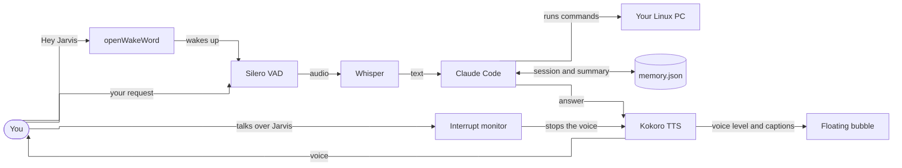

# Jarvis Voice Assistant for Linux

Say **"Hey Jarvis"**, ask for something out loud, and **Claude** does it on your computer and answers with a natural voice.


Jarvis is a small Python app that connects a wake word, speech recognition and a local text-to-speech voice to [Claude Code](https://docs.claude.com/en/docs/claude-code/overview). Claude Code is what actually acts on your PC, so Jarvis can do the same things it can: open apps, check your disk, find files, install things, explain errors, and more.

> "Hey Jarvis... how much free space do I have?"
> "You have about 127 gigabytes free, roughly 68 percent of your disk."

## Features

- **Hands-free wake word**: "Hey Jarvis" is detected offline with [openWakeWord](https://github.com/dscripka/openWakeWord). Nothing leaves your PC until you wake it up. The score has to hold for a moment, and the bar is higher while a video or music is playing, so voices on TV rarely wake it up.
- **Real actions on your PC**: requests are handled by Claude Code in non-interactive mode, with a safety-first permission mode.
- **Fast answers**: Jarvis starts speaking the first sentence while Claude is still writing the rest, and says a short "One moment, I'm checking that" when Claude has to run commands first, so there are no long silences.
- **Fast local voice**: [Kokoro](https://github.com/thewh1teagle/kokoro-onnx) speaks while the rest of the answer is still being generated. You can blend voices and make them deeper. Edge TTS is available as an online alternative or fallback.
- **Private, offline speech recognition**: Whisper runs on your own GPU or CPU with [faster-whisper](https://github.com/SYSTRAN/faster-whisper), so your voice never leaves your computer and no account is needed. On an RTX 4060 it transcribes a sentence in under half a second. Groq's free online Whisper API is available as an alternative.
- **Leaves your GPU to your games**: the Whisper model (int8, about 1.3 GB of VRAM) only loads when you say "Hey Jarvis" and is freed a minute after the conversation, so a sleeping Jarvis uses no VRAM. Say "turn on gaming mode" and speech recognition moves to the CPU while you play.
- **See what it does**: when Claude runs a command, a terminal window opens and shows every command and its output live, so you always know what Jarvis is doing on your PC. The same window follows the whole conversation and closes when Jarvis goes back to sleep.
- **Interrupt by voice**: start talking while Jarvis speaks and he stops and listens, keeping your first words. With speakers instead of a headset, switch to `wakeword` mode and say "Hey Jarvis" to interrupt.
- **Natural conversation**: keep talking without repeating the wake word. Say "thank you" (or "OK, thank you", "that's all", "gracias"...) and Jarvis goes back to sleep.
- **Memory with automatic compaction**: wake Jarvis again within a few hours and he continues the same conversation. When it grows too large, he summarizes it into short notes and starts fresh with that memory, so answers stay fast and cheap.
- **Language practice mode**: Jarvis can always answer in a language you are learning, and tell you how to say your request in that language when you switch to your native one.
- **A floating bubble, not a chat window**: a translucent capsule at the bottom of the screen with an animated orb. The orb breathes while Jarvis sleeps, swells with your voice while it listens, spins while it thinks and ripples with its own voice while it speaks. Captions show what you said and the sentence Jarvis is saying right now. Click the orb to interrupt. The bubble hides itself when the conversation ends.
- **Runs in the background** as a systemd user service and starts with your desktop.

## How it works



- **openWakeWord** listens offline for "Hey Jarvis". Nothing leaves your PC before that.
- **Silero VAD** records your request and waits if you pause in the middle of a sentence.
- **Whisper** turns it into text, locally with faster-whisper (GPU or CPU) or online with Groq. The local model runs in a child process that starts when Jarvis wakes up and ends after the conversation, freeing all of its memory.
- **Claude Code** (`claude -p --permission-mode auto`) does the task on your PC and keeps the conversation in `memory.json`, compacting it when it grows too large. Its answer is read as it is written (`--output-format stream-json`), so each sentence goes to the voice as soon as it is complete.
- **Kokoro** speaks the answer locally while the **floating bubble** shows the state and captions. If you start talking, the **interrupt monitor** stops the voice and Jarvis listens.

## Resource usage

Measured on an Intel i5-12400F (12 threads) with an RTX 4060, using `benchmark.py`:

| What Jarvis is doing | CPU (whole processor) | RAM | GPU memory |
|---|---|---|---|
| Sleeping, waiting for "Hey Jarvis" | about 1% | about 550 MB | 0 |
| Awake, local Whisper `large-v3-turbo` on the GPU | short bursts | +1.9 GB | +1.3 GB |
| Awake, gaming mode (Whisper `small` on the CPU) | short bursts | +0.7 GB | 0 |
| Speaking (Kokoro) | about 50% for 1 s per 6 s of speech | included above | 0 |
| Claude working (including the commands it runs) | about 2% | +200 MB | 0 |

- Whisper loads when you wake Jarvis (about 6 s on the GPU, 2 s on the CPU, while he greets you) and is freed 60 s after the conversation, so the extra memory is only used while you talk to him.
- Claude usage: Jarvis gives Claude Code only the 8 tools a voice assistant needs (`[claude] tools`) and skips your MCP servers and skills (`[claude] extensions`), so every request starts at about 11k tokens instead of 36k. A question that runs a command costs about 22k tokens, most of them cheap cached reads.
- Recognizing one sentence takes about 0.25 s on the GPU and 1 s in gaming mode. A simple request that runs one command took Claude (Haiku) about 7 s in total.

### Claude tokens and cost per question

Measured with `benchmark.py tokens --live` (three questions in one fresh conversation). Cost is at Anthropic's API prices; with a Claude subscription you pay the plan instead and the tokens count toward its usage limits.

| Question | Haiku 5.5 | Sonnet 5.5 |
|---|---|---|
| Chat answer, no tools | ~11k tokens, $0.0003 | ~10k tokens, $0.016 |
| Runs one command | ~22k tokens, $0.0008 | ~20k tokens, $0.036 |
| Runs a few commands | ~23k tokens, $0.0014 | ~21k tokens, $0.044 |

About 90% of those tokens are the conversation re-read from Claude's prompt cache, which costs a tenth (Haiku) or a twentieth (Sonnet) of a normal token. Claude's spoken answer itself is usually 50 to 500 tokens. Every request also logs its tokens and cost in `~/.local/state/jarvis/jarvis.log` (`Claude usage: ...`).

Measure your own computer:

```bash
python3 benchmark.py monitor 120     # watch the running service; talk to Jarvis meanwhile
~/.local/share/jarvis/venv/bin/python benchmark.py components --claude   # each piece on its own
python3 benchmark.py tokens          # tokens and cost of every question you asked Jarvis (free)
~/.local/share/jarvis/venv/bin/python benchmark.py tokens --live --model sonnet   # three sample questions
```

A narrated architecture walkthrough (Spanish, ~31 min) with its storyboard and Mermaid diagrams lives in [`docs/architecture-video`](docs/architecture-video/README.md).

## Requirements

- Linux with **PipeWire** (`pw-record`, `pw-play`) and **systemd**. This covers most modern distributions.
- **Python 3.11+** with `venv`, the **GTK 3** bindings (`python3-gi`, `python3-gi-cairo`) and, optionally, **gtk-layer-shell** so the bubble floats above other windows on Wayland.
- **[Claude Code](https://docs.claude.com/en/docs/claude-code/overview)** installed and logged in, with a Claude subscription or API access.
- For speech recognition, either a little disk space for the local Whisper model (about 1.6 GB, plus about 2 GB of CUDA libraries with an NVIDIA GPU) or a free **[Groq API key](https://console.groq.com/keys)**. The installer asks which one you prefer.
- About 500 MB of disk space for the Python packages and voice models.
- Optional: **playerctl** (`sudo apt install playerctl`), so Jarvis knows when a video or music is playing and is harder to wake up by mistake.
- A headset is recommended, so Jarvis does not hear itself or the people around you.

Tested on Pop!_OS 24.04 (COSMIC, Wayland).

## Installation

1. Install Claude Code and log in, if you have not already:

   ```bash
   curl -fsSL https://claude.ai/install.sh | bash
   claude auth login
   ```

2. Install Jarvis with one command:

   ```bash
   curl -fsSL https://raw.githubusercontent.com/ElvisGarcia009/jarvis-voice-assistant/main/get.sh | bash
   ```

   It downloads Jarvis to `~/.local/src/jarvis-voice-assistant`, offers to install the system packages it needs (it asks before using `sudo`), asks how to recognize your voice (locally or with Groq), downloads the models and starts Jarvis as a background service. At the end it shows a summary of what works and what is still missing. Run the same command again later to update Jarvis; your settings are kept.

3. Say **"Hey Jarvis"**.

<details>
<summary>Manual installation (without the one-command installer)</summary>

1. Install the system packages:

   ```bash
   # Debian / Ubuntu / Pop!_OS
   sudo apt install python3-venv python3-gi python3-gi-cairo gir1.2-gtk-3.0 gir1.2-gtklayershell-0.1 pipewire-bin curl git playerctl
   # Fedora
   sudo dnf install python3-gobject python3-cairo gtk3 gtk-layer-shell pipewire-utils curl git playerctl
   # Arch
   sudo pacman -S python-gobject python-cairo gtk3 gtk-layer-shell pipewire curl git playerctl
   ```

2. Clone this repository and run the installer (it does not need `sudo`):

   ```bash
   git clone https://github.com/ElvisGarcia009/jarvis-voice-assistant.git
   cd jarvis-voice-assistant
   ./install.sh
   ```

</details>

## Usage

| Action | How |
|---|---|
| Wake Jarvis | Say "Hey Jarvis", or run `systemctl --user kill --kill-whom=main -s USR1 jarvis` (bind it to a keyboard shortcut) |
| Ask something | Just talk after the greeting |
| Interrupt | Just start talking (or say "Hey Jarvis" in `wakeword` mode), click the orb, or the ■ button |
| Cancel a request | Click ✕, or the orb while Jarvis is thinking: Claude stops right away |
| Finish | Say "thank you" / "OK, thank you" / "that's all", stay silent, or click ✕ |
| Show or hide the commands | Say "deactivate terminal" / "activate terminal" (or "desactiva la terminal" / "activa la terminal") |
| Gaming mode | Say "turn on gaming mode" / "turn off gaming mode", or `touch` / `rm` `~/.local/state/jarvis/gaming_mode` |

Service commands:

```bash
systemctl --user restart jarvis     # after changing settings
systemctl --user stop jarvis        # turn it off
journalctl --user -u jarvis -f      # live log (also in ~/.local/state/jarvis/jarvis.log)
```

## Configuration

Edit `~/.config/jarvis/config.toml`, then restart the service. See [`config.example.toml`](config.example.toml) for every option.

```toml
[user]
name = "Alex"

[language]
reply = "English"     # or "auto" to answer in the language you speak
tutor = "Spanish"     # language practice mode

[voice]
engine = "kokoro"
kokoro_voice = "am_onyx+am_michael"   # blend voices with "+"
kokoro_speed = 1.15
kokoro_deepen = 0.08                  # deeper "butler" voice

[claude]
model = "sonnet"      # fast for voice; "opus" is smarter but slower
```

## Security

Jarvis gives a voice interface to a tool that can run commands on your computer. Please read this section.

- Anyone (or any video) near your microphone can say "Hey Jarvis". **Use a headset** and keep Jarvis off when you share the room or stream.
- Every command Jarvis runs is shown live in a terminal window (`[activity] show_terminal`) and saved in `~/.local/state/jarvis/activity.log`.
- Jarvis runs Claude Code with `--permission-mode auto`, which lets Claude Code's safety classifier block risky actions. Its instructions also tell it to ask for a spoken "yes" before deleting, uninstalling or changing settings. **Do not switch to `bypassPermissions`.**
- `sudo` does not work from Jarvis. It tells you to run those commands yourself.
- Conversation memory (a short summary and the session id) is stored locally in `~/.local/state/jarvis/memory.json`. Delete it to make Jarvis forget.
- Your Groq key is stored in `~/.config/jarvis/groq_key` with `600` permissions. Never commit it.
- With local speech recognition, your audio never leaves your computer. With Groq, audio is only sent **after** the wake word is detected. Your requests are sent to Anthropic through Claude Code, as with any Claude Code use.

## Troubleshooting

- **It never wakes up**: check that the right microphone is the default input, and look at the log. You can lower `[wake] threshold`.
- **It wakes up by mistake** (for example with videos): the log shows `Wake up (score ...)` for every wake-up and `Near miss: wake score ...` for sounds that almost woke it. Compare them with your own "Hey Jarvis", then raise `[wake] patience` to `3`, `[wake] media_threshold` (used while media plays, needs `playerctl`) or `[wake] threshold` (for example to `0.7`).
- **"I'm not logged in to Claude"**: run `claude auth login` in a terminal.
- **No voice**: test `pw-play /usr/share/sounds/freedesktop/stereo/complete.oga`. Kokoro falls back to Edge TTS automatically if it fails.
- **"Missing Groq API key"**: run `./install.sh` again, or write the key to `~/.config/jarvis/groq_key`.

## Uninstall

```bash
./uninstall.sh            # keeps your settings
./uninstall.sh --purge    # also deletes settings and the Groq key
```

## Credits and licenses

- Code: [MIT License](LICENSE).
- [openWakeWord](https://github.com/dscripka/openWakeWord) (Apache-2.0). The pre-trained "hey jarvis" model is released by its author under **CC BY-NC-SA 4.0** (non-commercial). It is downloaded at install time, not distributed here.
- [faster-whisper](https://github.com/SYSTRAN/faster-whisper) (MIT) with OpenAI's Whisper models (MIT).
- [Silero VAD](https://github.com/snakers4/silero-vad) (MIT), bundled with openWakeWord.
- [Kokoro-82M](https://huggingface.co/hexgrad/Kokoro-82M) (Apache-2.0) through [kokoro-onnx](https://github.com/thewh1teagle/kokoro-onnx) (MIT).
- [edge-tts](https://github.com/rany2/edge-tts) (LGPL-3.0), optional online voice.
- Speech recognition by [Groq](https://groq.com). Actions by [Claude Code](https://docs.claude.com/en/docs/claude-code/overview).

This is an independent community project. It is not affiliated with or endorsed by Anthropic, Groq, Microsoft or Marvel.
