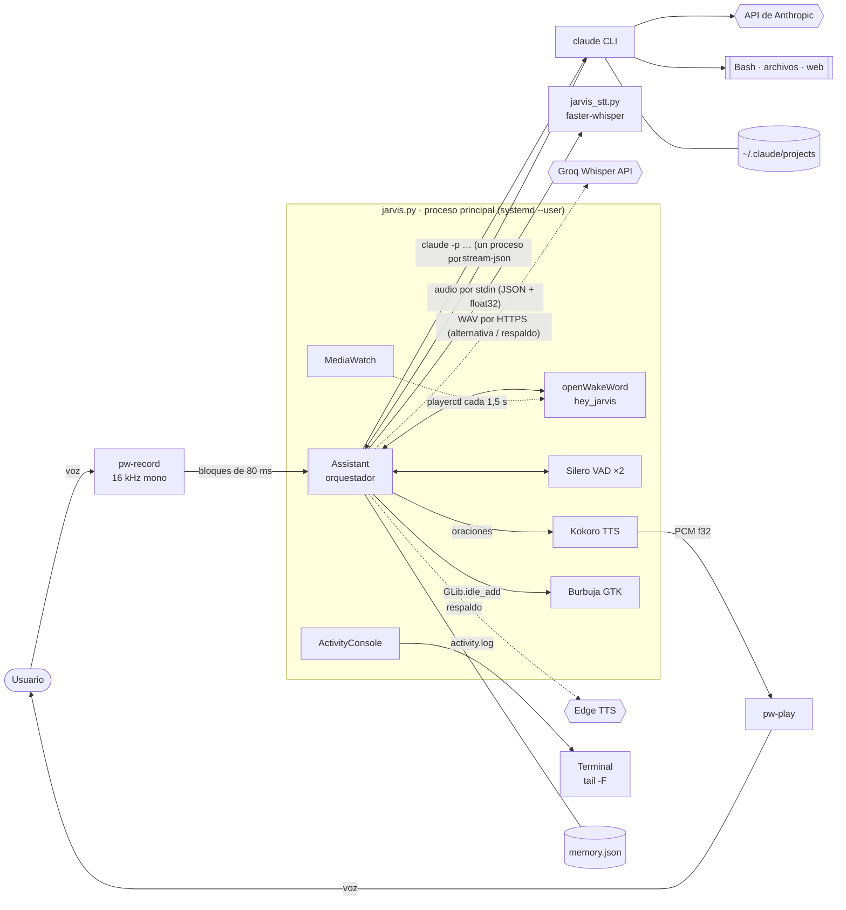
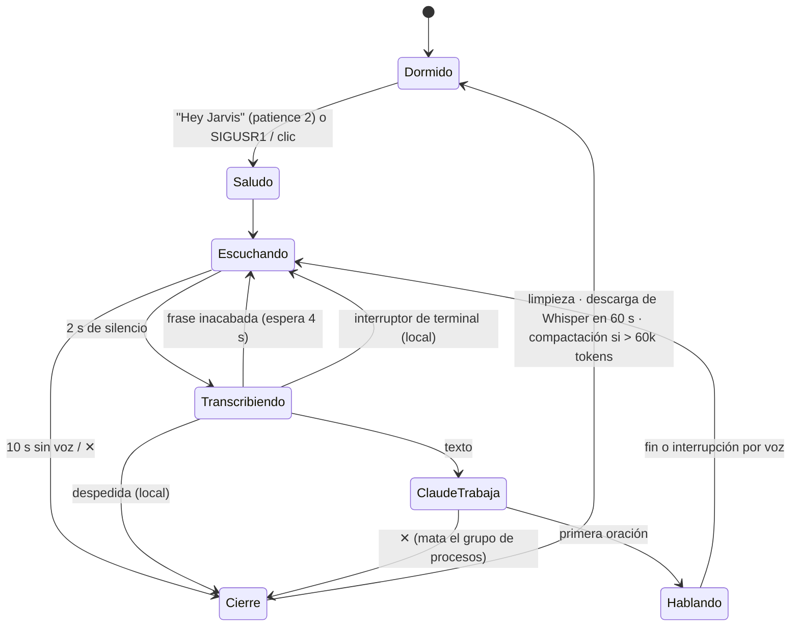
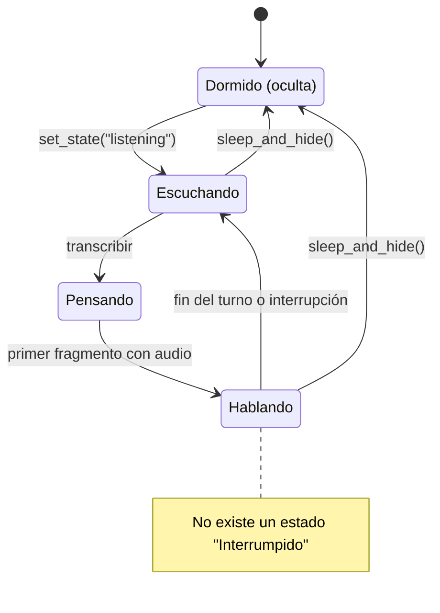
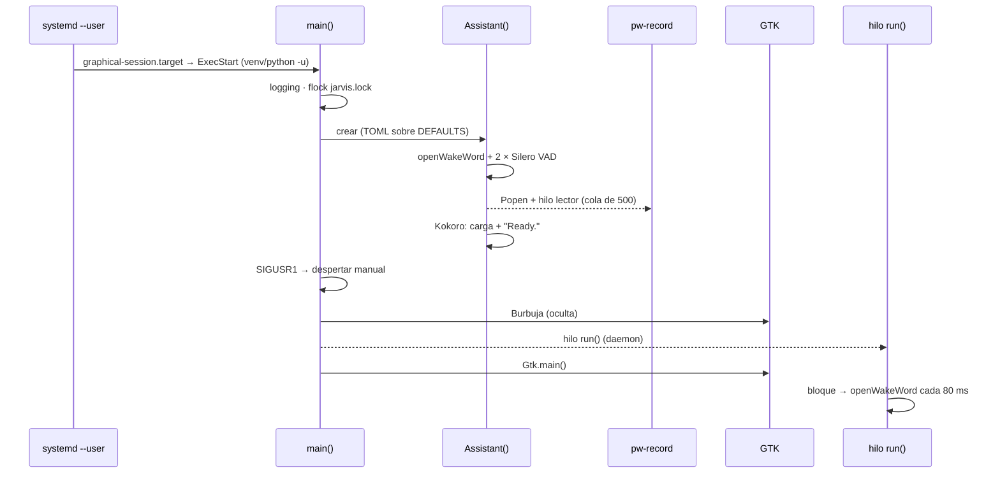
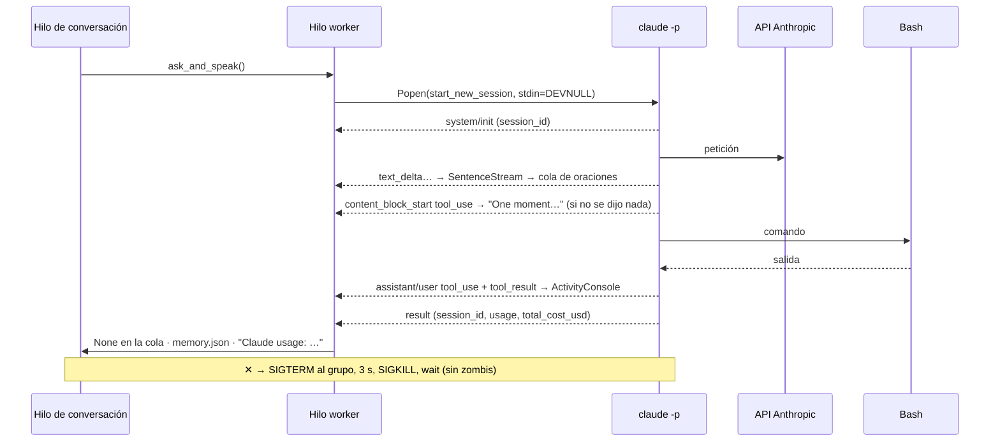
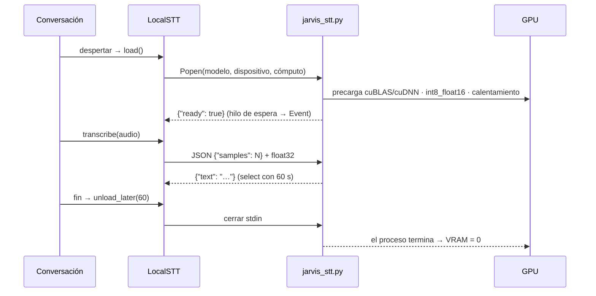
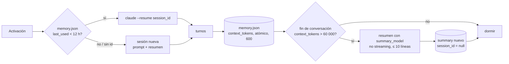

# Jarvis — diagramas de arquitectura (Mermaid)

Diagramas del video en formato Mermaid, verificados contra el código (`jarvis.py`, `jarvis_stt.py`, `jarvis_ui.py`, `install.sh`, `jarvis.service`). GitHub los dibuja directamente.

## 1. Componentes



## 2. Estados del sistema



## 3. Estados de la burbuja (`jarvis_ui.py`)



## 4. Arranque del servicio



## 5. Una petición a Claude Code



## 6. Ciclo de vida de Whisper local



## 7. Interrupción por voz (barge-in)

```mermaid
sequenceDiagram
    participant U as Usuario
    participant B as Monitor de interrupción
    participant S as pw-play
    participant W as Worker de Claude
    participant C as Conversación
    B->>B: ignora 0,3 s
    U->>B: voz (VAD > 0,5 durante ≥ 0,3 s)
    B->>B: guarda ≈ 0,8 s previos
    B->>S: speak_cancel + kill
    W->>W: sigue hasta terminar (no se cancela)
    C->>C: estado "escuchando"; la cola del mic sigue llenándose
    C->>C: listen(prefill) sin vaciar la cola
```

## 8. Memoria entre conversaciones


